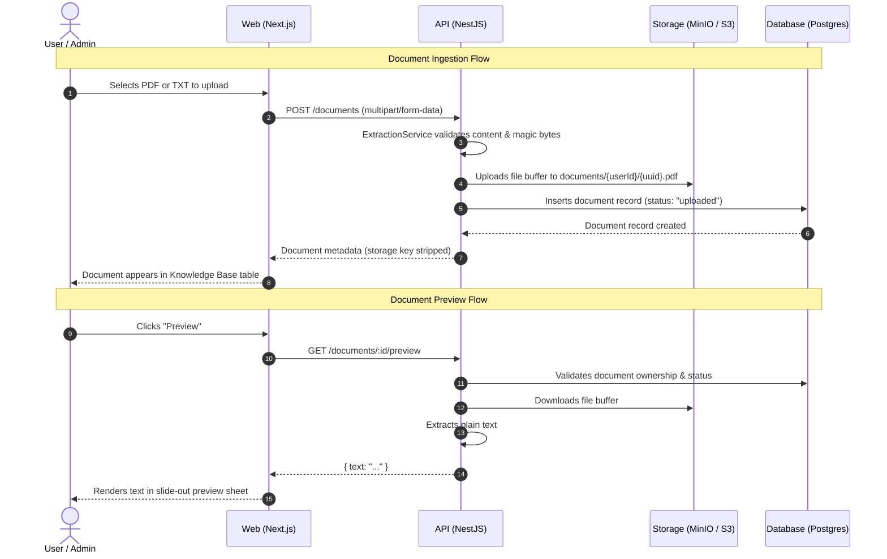

# Project-X (AgentDesk) — Architecture & Codebase Guide

This document provides a comprehensive technical overview of **Project-X (AgentDesk)**: its architecture, technologies and tools used, monorepo directory layout, existing features, and how components interact.

---

## 1. System Overview

**AgentDesk** is a customer support and knowledge-base platform designed for AI-assisted support workflows. It enables:
1. **Knowledge Base Management**: Organization and ingestion of documents (PDF, plain text).
2. **Document Processing Pipeline**: Text extraction, token-aware chunking, vector embedding, and persistent storage.
3. **Semantic Retrieval (RAG)**: Fast vector search over embedded chunks to provide grounding context for LLM responses.
4. **Agent Operations**: An automated agent and support ticket routing system.

---

## 2. Technology Stack & Tooling

The repository is organized as a monorepo managed with **Turborepo** and **pnpm workspaces**.

### Core Monorepo Infrastructure
| Tool | Version / Purpose |
| :--- | :--- |
| **pnpm** | `v11.18.0` — Workspace dependency manager |
| **Turborepo** | `v2.10.7` — Monorepo build system and parallel task runner |
| **TypeScript** | `v5.x` / `v6.x` — End-to-end type safety |

### Frontend (`apps/web`)
| Tool | Purpose |
| :--- | :--- |
| **Next.js 15 (App Router)** | React 19 framework utilizing Server and Client Components |
| **Tailwind CSS v4** | Modern utility-first CSS styling engine |
| **shadcn/ui & @base-ui/react** | Accessible UI primitives (Sheet, Dialog, Table, Form inputs) |
| **Lucide React** | Icon system |
| **TanStack React Query v5** | Server state caching, background refetching, and mutations |
| **Axios** | HTTP client configured with cookie credentials and response interceptors |
| **React Hook Form + Zod** | Form management and schema validation |
| **Sonner** | Toast notifications |

### Backend (`apps/api`)
| Tool | Purpose |
| :--- | :--- |
| **NestJS 11** | Scalable, modular enterprise backend architecture |
| **Passport & JWT** | Session authentication using secure HTTP-only cookies |
| **Argon2** | High-security cryptographic password hashing |
| **Drizzle ORM** | Type-safe SQL query builder and schema management |
| **AWS SDK v3 (`@aws-sdk/client-s3`)** | Object storage operations for S3 and MinIO |
| **pdf-parse** | PDF text parsing |
| **gpt-tokenizer** | BPE tokenization for chunking text within LLM token limits |
| **nestjs-pino / pino-http** | Structured, JSON-formatted request and application logging |
| **class-validator / class-transformer** | Runtime DTO validation and config validation |
| **Jest & ts-jest** | Unit and integration testing |

### Database & Storage
| Tool | Purpose |
| :--- | :--- |
| **PostgreSQL 15** | Primary relational database |
| **Drizzle Kit** | SQL migration generation and database schema synchronization |
| **MinIO** | S3-compatible local object storage with auto-created bucket (`agentdesk-dev`) |
| **pgvector** | PostgreSQL vector extension for embedding cosine similarity search |

---

## 3. Directory Structure

```
Project-x/
├── apps/
│   ├── api/                           # NestJS Backend API (Port 3001)
│   │   ├── src/
│   │   │   ├── config/                # Environment validation (class-validator)
│   │   │   ├── modules/
│   │   │   │   ├── auth/              # JWT auth, Passport strategy, cookies
│   │   │   │   ├── users/             # User entity queries
│   │   │   │   ├── database/          # Drizzle connection pool provider
│   │   │   │   ├── storage/           # S3 / MinIO client service
│   │   │   │   ├── extraction/        # PDF & TXT text extraction & validation
│   │   │   │   ├── chunking/          # Token-aware text chunking engine
│   │   │   │   ├── documents/         # Document metadata, upload & preview API
│   │   │   │   ├── agent/             # (Planned: LLM Agent execution)
│   │   │   │   ├── conversations/     # (Planned: Chat session management)
│   │   │   │   ├── tickets/           # (Planned: Support tickets)
│   │   │   │   └── tools/             # (Planned: Agent tool calling)
│   │   │   ├── app.module.ts          # Root module registering all features
│   │   │   └── main.ts                # App bootstrapper, CORS, cookies, pipes
│   │   ├── jest.config.js             # Jest test configuration
│   │   ├── package.json
│   │   └── tsconfig.json
│   └── web/                           # Next.js Frontend Application (Port 3000)
│       ├── app/
│       │   ├── (auth)/
│       │   │   ├── login/page.tsx     # Sign-in page
│       │   │   └── register/page.tsx  # Sign-up page
│       │   ├── dashboard/
│       │   │   ├── knowledge-base/    # Knowledge Base document management page
│       │   │   ├── layout.tsx         # Dashboard sidebar & header layout
│       │   │   └── page.tsx           # Dashboard main page
│       │   ├── layout.tsx             # Root layout with QueryClientProvider & Toaster
│       │   ├── middleware.ts          # Route protection checking 'access_token' cookie
│       │   └── globals.css            # Tailwind styling tokens
│       ├── components/
│       │   ├── dashboard/             # Header, Sidebar, Navigation
│       │   ├── feedback/              # Empty states, status indicators
│       │   └── ui/                    # Base UI / shadcn primitives (Sheet, Table, Button)
│       ├── features/
│       │   ├── auth/                  # Login/Register hooks, API, Zod schemas
│       │   └── documents/             # Upload, Document List, Preview components
│       ├── lib/
│       │   ├── api/                   # Axios client with interceptors
│       │   └── routes.ts              # Route path definitions
│       └── package.json
├── packages/
│   ├── config/                        # Shared ESLint and TypeScript configs
│   │   ├── eslint-preset.js
│   │   └── tsconfig.base.json
│   ├── db/                            # Drizzle ORM schema & migrations
│   │   ├── migrations/                # Generated SQL migration files (0000 - 0003)
│   │   ├── schema/
│   │   │   ├── users.ts               # User accounts table
│   │   │   ├── auth_accounts.ts       # OAuth account links
│   │   │   └── documents.ts           # Document metadata table
│   │   ├── drizzle.config.ts          # Drizzle Kit configuration
│   │   ├── index.ts                   # Exported schemas and types
│   │   ├── migrate.ts                 # CLI migration runner
│   │   └── package.json
│   └── shared-types/                  # Shared TypeScript models across web & api
│       ├── agent.ts
│       ├── auth.ts
│       └── documents.ts
├── docker/
│   └── docker-compose.yml             # Postgres & MinIO service configurations
├── docs/                              # Project documentation
│   ├── API.md
│   └── ARCHITECTURE.md
├── package.json                       # Root package config
├── pnpm-workspace.yaml                # pnpm workspace definition
└── turbo.json                         # Turborepo task pipeline
```

---

## 4. Completed Features

### 1. Authentication & Security (Milestone 1)
- **Registration & Login**: Secure credential authentication via `/auth/register` and `/auth/login`.
- **Password Security**: Passwords hashed using Argon2.
- **Session Transport**: JWT tokens sent via **HTTP-only, SameSite cookies** (`access_token`).
- **Authorization Guard**: [`JwtAuthGuard`](file:///c:/Users/dagih/Desktop/code/Project-x/apps/api/src/modules/auth/guards/jwt-auth.guard.ts) validates cookies across protected endpoints.
- **Frontend Route Protection**: [`middleware.ts`](file:///c:/Users/dagih/Desktop/code/Project-x/apps/web/middleware.ts) automatically protects `/dashboard/*` routes and redirects unauthorized visitors to `/login`.

### 2. Object Storage Foundation
- **[`StorageService`](file:///c:/Users/dagih/Desktop/code/Project-x/apps/api/src/modules/storage/storage.service.ts)**: Interacts with MinIO locally and S3 in production.
- **Safe Object Keys**: Files stored using UUID keys (`documents/{userId}/{uuid}.{ext}`) to eliminate path traversal vulnerabilities and hide original filenames.
- **Atomic Rollback**: Deletes uploaded S3 objects if database metadata persistence fails.

### 3. Document Extraction & Validation
- **[`ExtractionService`](file:///c:/Users/dagih/Desktop/code/Project-x/apps/api/src/modules/extraction/extraction.service.ts)**:
  - Supports PDF (`application/pdf`) and Text (`text/plain`).
  - Verifies PDF magic bytes (`%PDF-`) to reject disguised binary files.
  - Detects null bytes in text files to prevent binary injection.
  - Normalizes line endings (`\r\n` -> `\n`) and excessive whitespace.

### 4. Text Chunking Engine
- **[`ChunkingService`](file:///c:/Users/dagih/Desktop/code/Project-x/apps/api/src/modules/chunking/chunking.service.ts)**:
  - Uses `gpt-tokenizer` (BPE tokenizer).
  - Defaults to **500 tokens** per chunk with **50 tokens overlap** (configurable via environment).
  - Preserves paragraph boundaries (`\n\n`) when possible before falling back to token slicing.
  - Outputs structured chunk metadata: `{ index, documentId, text, tokenCount }`.

### 5. Knowledge Base UI
- **Upload Component**: Drag-and-drop or file selector with client-side file-size checks (5MB limit) and instant status feedback.
- **Document List Table**: Displays filename, upload date, size, and processing status (`uploaded`, `processing`, `ready`, `failed`).
- **Document Text Preview**: Resizable slide-out sheet (`sheet.tsx`) fetching extracted plain text from `GET /documents/:id/preview`.
- **Document Deletion**: Deletes both object storage file and database record with instant cache invalidation via React Query.

---

## 5. Data Flow Diagram



---

## 6. How to Run Locally

### Prerequisites
- Node.js >= 20
- pnpm >= 11
- Docker Desktop (for Postgres & MinIO)

### 1. Install Dependencies
```bash
pnpm install
```

### 2. Start Infrastructure
```bash
docker compose -f docker/docker-compose.yml up -d
```
This spins up:
- **PostgreSQL**: `localhost:5432` (`postgres:postgres`)
- **MinIO S3**: `localhost:9000` (Console on `localhost:9001`)

### 3. Run Database Migrations
```bash
pnpm --filter @agentdesk/db db:migrate
```

### 4. Start Development Servers
```bash
pnpm dev
```
- Web: `http://localhost:3000`
- API: `http://localhost:3001`

### 5. Run Tests
```bash
pnpm --filter api test
```

---

## 7. Current Project Roadmap

| Phase | Milestone | Features | Status |
| :--- | :--- | :--- | :--- |
| **Milestone 1** | Auth & Foundation | Users, Argon2, JWT cookies, Monorepo setup | **Completed** |
| **Milestone 2** | Knowledge Base | S3 Storage, Text Extraction, Chunking Engine, KB UI | **Completed** |
| **Milestone 2 (Cont.)** | Vector Embeddings | `document_chunks` table, pgvector, Embedding Provider, BullMQ Worker | **Completed** |
| **Milestone 3** | Semantic Search & RAG | Cosine distance search, context retrieval | **Upcoming** |
| **Milestone 4** | AI Agent & Tickets | Agent runtime, support tickets, conversation threads | **Upcoming** |
